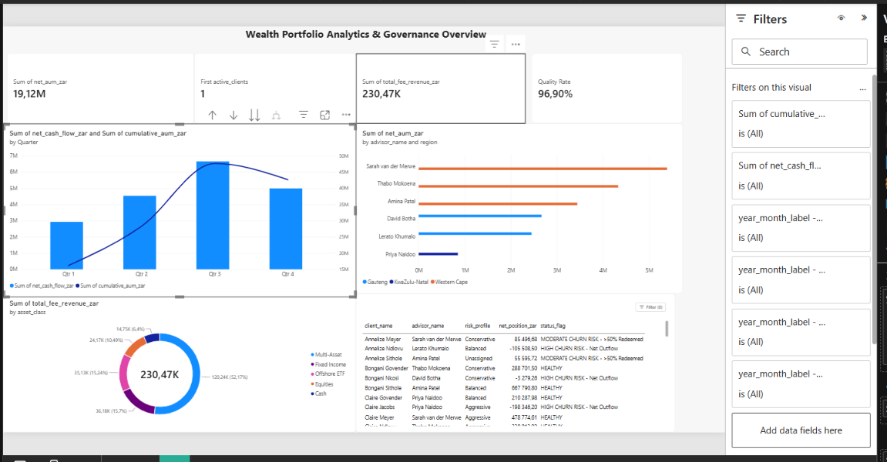

# Wealth Portfolio Analytics & Data Quality Pipeline

An end-to-end **Wealth Management Data Warehouse, Automated Quality Gate, and Power BI Reporting Solution** built in **Python, MySQL 8.0, and Power BI**.

Designed to mirror enterprise wealth analytics workflows, this project ingests raw client, advisor, asset, and transaction extracts, enforces automated data-quality and quarantine rules before warehouse loading, reconciles source-to-target totals, and surfaces executive AUM, fee revenue, and client churn insights.

---

## Executive Dashboard Preview



*Interactive Power BI report located at [`dashboard/wealth_overview.pbix`](dashboard/wealth_overview.pbix), powered by governed semantic marts in [`data/marts/`](data/marts/).*

---

## Architecture & Data Lineage

```text
┌─────────────────────┐     ┌──────────────────────────────────┐     ┌─────────────────────────┐
│   Raw CSV Sources   │     │   Python ETL & Quality Gate      │     │   MySQL Star Schema     │
│  (data/raw/*.csv)   │────►│      (src/etl_pipeline.py)       │────►│       (wealth_dw)       │
│                     │     │                                  │     │                         │
│ • advisors.csv      │     │ • Schema & type validation       │     │ • fact_transactions     │
│ • assets.csv        │     │ • Duplicate & orphan detection   │     │ • dim_client            │
│ • clients.csv       │     │ • KYC risk_profile imputation    │     │ • dim_advisor           │
│ • transactions.csv  │     │ • Fee & net ZAR calculations     │     │ • dim_asset / dim_date  │
└─────────────────────┘     └────────────────┬─────────────────┘     └────────────┬────────────┘
                                             │                                    │
                                 Failed Rows │                        Semantic    │
                                             ▼                         Views      ▼
                            ┌──────────────────────────────────┐     ┌─────────────────────────┐
                            │        Quarantine Layer          │     │   BI Marts & Power BI   │
                            │ • quarantine_transactions (DB)   │     │ • vw_aum_by_advisor...  │
                            │ • rejected_transactions.csv      │     │ • vw_monthly_net_flows  │
                            └──────────────────────────────────┘     │ • vw_fee_revenue...     │
                                                                     │ • vw_client_churn...    │
                                                                     
 
KEY ENGINEERING & GOVERNANCE FEATURES
 1.Synthetic Data Generator with Deliberate Anomalies (src/generate_data.py)
   -Generates South African wealth management data denominated in ZAR across Western Cape, Gauteng, and KwaZulu-Natal branches.
   -Injects real-world data defects (5 duplicate transaction IDs, 4 negative unit prices, 4 orphan client references, 3 zero-unit 
    trades, and missing client KYC risk profiles) to validate pipeline resilience.

 2.Dimensional Star Schema (sql/01_ddl_star_schema.sql)
   -Models fact_transactions linked to dim_client, dim_advisor, dim_asset, and dim_date with surrogate keys, foreign key constraints, 
    and analytical indexes.

 3.Automated Quality Gate & Quarantine Isolation (src/etl_pipeline.py)
   -Prevents silent data corruption by isolating malformed rows into both a MySQL quarantine_transactions table and data/quarantined/
    rejected_transactions.csv with explicit error reasons.
   -Standardizes missing client risk_profile values to 'Unassigned' so valid client transactions are preserved while flagging KYC  
    remediation tasks.

 4.Source-to-Target Reconciliation (src/quality_checks.py & sql/03_reconciliation_tests.sql)
   -Automated Python assertions and SQL audit queries prove zero silent data loss (516 Raw = 500 Valid + 16 Quarantined), verify 
    financial arithmetic (gross_amount ± fee_amount = net_amount), and confirm cross-view AUM consistency.

 5.Governed Semantic SQL Views (sql/02_analytical_views.sql)
   -Uses CTEs, conditional aggregations, and window functions (SUM(...) OVER (ORDER BY ...)) to calculate cumulative AUM growth, advisor 
    book performance, fee yield by asset class, and client churn risk flags.


Sample Reconciliation & Audit Output

============================================================
AUTOMATED DATA QUALITY & RECONCILIATION REPORT: PASSED
============================================================
Source Raw Transactions:      516
Loaded Valid Fact Rows:       500
Quarantined Anomaly Rows:     16
Unaccounted Rows:             0
------------------------------------------------------------
Quarantine Breakdown by Rule:
  - [5 rows] Duplicate transaction_id
  - [4 rows] Negative unit_price
  - [4 rows] Orphan client_id
  - [3 rows] Non-positive units
============================================================

Repository Structure

wealth-analytics-pipeline/
├── data/
│   ├── raw/                  # Synthetic source CSV extracts
│   ├── quarantined/          # Rejected records with audit error reasons
│   └── marts/                # Exported CSV marts consumed by Power BI
├── docs/
│   ├── data_dictionary.md    # Star schema definitions, grain & business rules
│   └── runbook.md            # Setup, execution & troubleshooting guide
├── sql/
│   ├── 01_ddl_star_schema.sql
│   ├── 02_analytical_views.sql
│   └── 03_reconciliation_tests.sql
├── src/
│   ├── generate_data.py      # Reproducible dataset & anomaly generator
│   ├── etl_pipeline.py       # Idempotent ETL, quality gate & mart exporter
│   └── quality_checks.py     # Automated reconciliation test suite
├── dashboard/
│   ├── wealth_overview.pbix
│   └── dashboard_preview.png
├── requirements.txt
└── README.md


Quickstart

# 1. Install dependencies
pip install -r requirements.txt

# 2. Create database schema & views in MySQL 8.0+
mysql -u root -p < sql/01_ddl_star_schema.sql
mysql -u root -p < sql/02_analytical_views.sql

# 3. Set credentials and run the pipeline + reconciliation checks
export MYSQL_PASSWORD="your_password"
python src/generate_data.py
python src/etl_pipeline.py
python src/quality_checks.py
Full operational instructions are documented in docs/runbook.md.                                                                   

